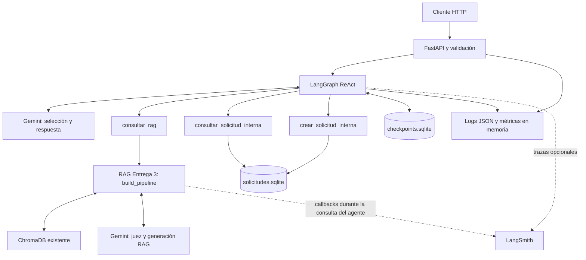

# Informe técnico — TP Final Integrador

**Grupo E — integrantes:** Franca Bruno, Franzoni Clara, Rodrigo Martinez, Nicolas Lucas Grassi.

## 1. Introducción

Un estudio contable debe responder consultas documentales y organizar tareas administrativas sin confundir orientación general con la confirmación de operaciones fiscales reales. El sistema desarrollado combina recuperación documental con un agente que puede consultar o registrar solicitudes ficticias y conservar el contexto de una conversación.

El alcance implementado es una aplicación académica ejecutable localmente mediante FastAPI. No se conecta con organismos fiscales ni efectúa pagos, declaraciones o comunicaciones externas. Aunque incorpora persistencia, observabilidad y controles de seguridad, no se presenta como un servicio preparado para producción pública.

Este informe describe la implementación existente y se apoya en el [README](README.md), el código de `src/grupo_e_tp_integrador_dsi/`, los componentes reutilizados de `entrega_3/rag_pipeline/` y las pruebas de `tests/`. Los requisitos de referencia fueron proporcionados por el usuario; no se verificó un documento original de consigna. La evidencia histórica aportada se distingue de las verificaciones ejecutadas durante esta etapa.

## 2. Objetivos

El objetivo general es integrar un agente conversacional del dominio contable que combine evidencia documental, lectura del estado administrativo y registro controlado de tareas ficticias.

Los objetivos específicos son:

- Implementar un ciclo ReAct con LangGraph y tres herramientas con argumentos explícitos.
- Reutilizar el RAG de la Entrega 3 y conservar sus abstenciones.
- Persistir conversaciones con checkpoints SQLite e identificar cada historial mediante `thread_id`.
- Exponer contratos REST con validaciones estructurales y errores controlados.
- Registrar actividad mediante logs JSON, métricas y trazas opcionales en LangSmith.
- Rechazar patrones de manipulación y reducir la exposición de PII en las respuestas HTTP.
- Verificar el comportamiento con pruebas reproducibles que no dependan de proveedores externos.

## 3. Arquitectura de la solución

FastAPI administra el ciclo de vida de una única instancia de `AgenteContable`. Su `lifespan` utiliza `AgenteContable.abrir()`, conserva la instancia en `app.state.agente` y cierra sus recursos al finalizar. La importación del módulo no abre conexiones SQLite ni inicializa modelos externos.

`AgenteContable` construye un `StateGraph` con nodos `modelo` y `herramientas`. Gemini propone las llamadas; el grafo ejecuta las herramientas y devuelve sus resultados al modelo hasta obtener una respuesta final o una terminación controlada. No se expone razonamiento interno en el contrato HTTP.

El adaptador `GeminiAgente`, definido en [modelo_agente.py](src/grupo_e_tp_integrador_dsi/modelo_agente.py), utiliza por defecto `gemini-3.1-flash-lite`. `bind_tools()` convierte los esquemas Pydantic de las herramientas en declaraciones de funciones para Gemini. El SDK recibe `automatic_function_calling.disable=True`: esto desactiva su ejecución automática de funciones, mientras `function_calling_config.mode="AUTO"` permite que el modelo proponga llamadas. La ejecución queda bajo control de LangGraph.

| Componente | Responsabilidad y decisión |
| --- | --- |
| `consultar_rag` | Consulta documental con el pipeline existente, sin duplicar recuperación ni generación. |
| `consultar_solicitud_interna` | Sensor: abre la base administrativa en modo de solo lectura y devuelve existencia y datos públicos. |
| `crear_solicitud_interna` | Actuador: crea una solicitud ficticia persistente, inicialmente `pendiente`. |
| `checkpoints.sqlite` | Memoria del grafo mediante `AsyncSqliteSaver`; permite continuidad y reapertura. |
| `solicitudes.sqlite` | Estado administrativo separado de la memoria conversacional. |
| `chroma_db/` | Conocimiento documental ya preparado; el agente no reconstruye colecciones ni embeddings. |

Las rutas predeterminadas son `data/agente/checkpoints.sqlite`, `data/agente/solicitudes.sqlite` y `chroma_db/`, resueltas desde la raíz del proyecto. La separación de archivos SQLite facilita aislar y probar cada responsabilidad, pero no proporciona una transacción común entre la acción y su checkpoint.

El proyecto declara Python ≥3.14; el entorno verificado utiliza CPython 3.14.8. Las dependencias directas y transitivas se describen en `pyproject.toml`, `requirements.txt` y `uv.lock`. El README contiene los comandos de instalación y ejecución, evitando repetir aquí la guía operativa.

## 4. Funcionamiento del agente

### Recepción y ciclo de ejecución

`POST /consultar` valida primero el esquema Pydantic y luego aplica los validadores de seguridad. Una consulta aceptada adquiere la coordinación por hilo y ejecuta `await agente.ainvoke(pregunta, thread_id=thread_id)` sobre la instancia compartida.

`ainvoke()` incorpora un `HumanMessage`, reinicia los contadores de la invocación y conserva el historial previo mediante el checkpointer. `_modelo()` envía el mensaje de sistema y el historial al adaptador. Si Gemini devuelve llamadas, `_herramientas()` las ejecuta secuencialmente y agrega sus `ToolMessage`; si devuelve texto final, el grafo termina.

Las instrucciones del sistema asignan las preguntas documentales al RAG, las consultas de solicitudes al sensor y los registros explícitamente solicitados al actuador. También permiten respuestas directas, por ejemplo a saludos. Las pruebas con un modelo guionado verifican esas rutas de ejecución, pero no miden por sí mismas la precisión de selección de Gemini real.

### Límites, resultados y errores

Los valores predeterminados son seis invocaciones del modelo y ocho llamadas a herramientas por consulta. Cada llamada cuenta por separado, incluso dentro de un lote. El constructor admite enteros entre 1 y 50 y configura además un límite de recursión del grafo.

Los resultados públicos del agente son `finalizada`, `sin_evidencia`, `requiere_vinculacion`, `limite` y `error`. Ante las dos abstenciones del RAG, el nodo de herramientas finaliza de forma controlada sin pedir al modelo que complete la respuesta con conocimiento propio. Los errores de modelo, herramienta o grafo se convierten en mensajes genéricos. Alcanzar un límite no revierte acciones ya realizadas.

### Memoria e idempotencia

`thread_id` identifica el historial persistido; no identifica de forma autenticada a una persona. La API serializa invocaciones y lecturas del mismo hilo mediante un bloqueo compartido y permite progreso concurrente entre hilos distintos. Esta coordinación está limitada a un proceso.

En [solicitudes.py](src/grupo_e_tp_integrador_dsi/solicitudes.py), `crear_solicitud()` valida categoría, descripción de hasta 200 caracteres, clave de idempotencia y referencia documental opcional. Usa consultas parametrizadas y una restricción `UNIQUE` sobre la clave. La repetición con igual contenido devuelve `existente`; con contenido diferente devuelve `conflicto`. Los identificadores se generan con UUID y la fecha se guarda en UTC.

La acción administrativa se confirma en una transacción distinta del checkpoint. Si la acción queda guardada y luego falla la memoria, repetirla con la misma clave mantiene la protección; una nueva clave puede crear otra solicitud. Por tanto, no existe garantía de ejecución exactamente una vez entre ambas bases. Este riesgo se deriva de la arquitectura; no se presenta como un fallo de checkpoint reproducido en esta etapa.

## 5. Integración del RAG

[Herramienta RAG](src/grupo_e_tp_integrador_dsi/herramienta_rag.py) reutiliza `build_pipeline(Settings(variant="rerank"))`. La inicialización es diferida y única por instancia, protegida por un bloqueo. Su interfaz es asíncrona y delega `pipeline.invoke()` a `asyncio.to_thread()` para evitar bloquear el event loop. No expone filtros ni rutas internas al modelo.

El pipeline existente distingue cuatro responsabilidades:

1. **Recuperación:** `RetrieverContable` consulta ChromaDB con los componentes de embeddings existentes. La variante `rerank` utiliza la colección `estudio_contable_chunks` y recupera hasta ocho candidatos con la configuración predeterminada.
2. **Reranking:** el juez evalúa relevancia explícita y devuelve JSON validado mediante `Verdict`. Se rechazan IDs desconocidos y duplicados. La configuración selecciona hasta cuatro documentos con puntuación mínima 0,5.
3. **Generación:** `GENERATION_PROMPT` solicita responder exclusivamente con el contexto y citar fuentes. La generación sigue a cargo del pipeline original.
4. **Guardrails:** se conservan la abstención por evidencia insuficiente, la comprobación existente de vinculación documental para consultas personales con CUIT y la validación del juicio. Estas reglas no constituyen una autorización ni una validación fiscal real.

La adaptación publica `resultado`, `respuesta` y hasta cuatro referencias documentales, sin contenido completo de chunks, embeddings ni candidatos. `insufficient_context` se convierte en `sin_evidencia`; `insufficient_client_binding`, en `requiere_vinculacion`. Un estado `ok` requiere respuesta y fuentes válidas para publicarse como `respondida`; la frase de abstención también se conserva si el generador la produjo con `ok`. Los fallos o estados desconocidos producen `error`. El agente utiliza estos datos internos, pero su endpoint no añade un campo separado de fuentes al contrato público.

### Estrategia de prompting

El agente utiliza **zero-shot**: `SISTEMA` contiene instrucciones de dominio y uso de herramientas, sin ejemplos demostrativos de entrada/salida. La generación RAG también es **zero-shot**, mediante `GENERATION_PROMPT`, y el juez define instrucciones y un esquema sin demostraciones. El historial de conversación y los documentos recuperados no equivalen a ejemplos few-shot diseñados para enseñar la tarea. Los ejemplos internos de evaluadores RAGAS pertenecen a evaluación y no deben atribuirse al prompting del agente.

La evidencia está en [agente.py](src/grupo_e_tp_integrador_dsi/agente.py), [pipeline.py](entrega_3/rag_pipeline/pipeline.py) y [reranking.py](entrega_3/rag_pipeline/reranking.py). No se modificó Entrega 3 para esta integración documental.

## 6. API REST

| Endpoint | Contrato y comportamiento |
| --- | --- |
| `GET /health` | HTTP 200 con `status="ok"` y `service="agente-contable"`. Comprueba atención de la aplicación, no disponibilidad de proveedores. |
| `POST /consultar` | Recibe `thread_id` y `pregunta`; devuelve `thread_id`, `resultado` y `respuesta`. Reutiliza la instancia del lifespan y su memoria. |
| `GET /estado/{thread_id}` | Devuelve `thread_id`, `existe`, `cantidad_mensajes` y `ultimo_resultado`, sin mensajes ni contenido de checkpoints. Un hilo inexistente responde 200, `false`, cero y `null`. |
| `GET /metricas` | Devuelve el snapshot del registro asociado a la aplicación, sin modificar contadores ni ejecutar herramientas. Si el registro falla, responde 503 genérico. |

`thread_id` debe ser una cadena no vacía de hasta 128 caracteres y `pregunta`, de hasta 2000. El modelo de solicitud rechaza campos adicionales y tipos incorrectos. La respuesta del agente conserva los estados públicos existentes; `error` controlado puede llegar con HTTP 200. Una excepción inesperada de `/consultar` o `/estado` produce HTTP 500 con un mensaje genérico.

Los rechazos de entrada devuelven 422 con `detail.motivo`; por ejemplo, `prompt_injection` o `estructura_invalida`. No reflejan el contenido rechazado. Si hay a la vez un defecto estructural y uno de seguridad, prevalece la clasificación estructural. La validación de `/estado` también evita reflejar el ID inválido.

`cantidad_mensajes` incluye los mensajes de herramientas persistidos, no solo turnos visibles del usuario. `ultimo_resultado` se obtiene de `final` únicamente si su estructura pública es confiable; en caso contrario devuelve `null`, sin inferirlo del texto. La consulta de estado utiliza el mismo bloqueo por hilo que la escritura.

## 7. Observabilidad

### Logs y métricas

[Observabilidad](src/grupo_e_tp_integrador_dsi/observabilidad.py) utiliza `logging` estándar con un formatter JSON y configuración idempotente de handlers. Los eventos incluyen inicio y cierre de aplicación, inicio y fin de consultas aceptadas, errores, herramientas y límites. Los campos permitidos incluyen timestamp UTC, nivel, evento, duración y resultado público. La PII reconocible de un ID de hilo se enmascara al emitirlo; si ese filtro falla, se omite el campo. No se registran preguntas, respuestas completas, argumentos de herramientas ni excepciones crudas en los logs propios.

[RegistroMetricas](src/grupo_e_tp_integrador_dsi/metricas.py) mantiene un registro independiente por aplicación, protegido con un bloqueo para las actualizaciones y snapshots. Un `ContextVar` asocia las ejecuciones de herramientas con la consulta activa y evita duplicar el conteo entre API y grafo.

Cada POST recibido suma una consulta, incluidos los 422. Una respuesta 200 con resultado público suma una completada. HTTP 5xx, excepciones inesperadas o resultado público `error` incrementan errores una vez. Cada herramienta ejecutada se contabiliza individualmente. Los rechazos de seguridad suman un bloqueo; los 422 estructurales no lo hacen.

La latencia usa un reloj monotónico. Incluye el procesamiento HTTP, la espera por hilo y la ejecución de consultas aceptadas, también cuando fallan; excluye los rechazos previos al agente. Para n muestras reales, el promedio es su suma dividida por n y el p95 utiliza rango más próximo: `sorted(muestras)[ceil(0.95*n)-1]`. Sin muestras ambos valores son cero. Se conservan todas las muestras en memoria para ese cálculo exacto; no hay persistencia ni agregación entre procesos.

### LangSmith y consumo del modelo

[Trazabilidad](src/grupo_e_tp_integrador_dsi/trazabilidad.py) configura trazas opcionales mediante `LANGSMITH_TRACING`; también admite el alias `LANGCHAIN_TRACING_V2` si la primera variable no existe. La configuración explícita `false` desactiva las trazas. `LANGSMITH_PROJECT` selecciona proyecto y el SDK utiliza la credencial y el endpoint configurados para LangSmith.

Durante una consulta del agente se suprime el tracing automático de payloads y se crean spans acotados para la consulta, el modelo, las herramientas y las etapas internas del RAG. El contexto se propaga también al trabajo delegado a un hilo. Solo se publican metadatos permitidos, resultados públicos, nombres y consumo informado. Los errores de tracing se registran de forma controlada sin convertirlos en fallos funcionales de la consulta.

Gemini aporta tokens de entrada, salida y totales cuando están disponibles; su ausencia no se sustituye por estimaciones. Las pruebas locales validan tanto consumo informado como no informado.

Como evidencia histórica proporcionada por el usuario, se registra una prueba real previa exitosa:

| Indicador | Valor de esa ejecución |
| --- | ---: |
| Etapas verificadas | 11 |
| Llamadas LLM | 4 |
| Tokens de entrada | 4.764 |
| Tokens de salida | 1.170 |
| Tokens totales | 5.934 |

Estos valores corresponden a una ejecución concreta y no a promedios, objetivos de rendimiento ni un benchmark general. La prueba no se repitió durante la auditoría final ni durante esta redacción. Los costos calculados por LangSmith dependen de su configuración de precios y no equivalen a facturación confirmada del proveedor.

## 8. Seguridad

[Seguridad](src/grupo_e_tp_integrador_dsi/seguridad.py) contiene funciones locales y determinísticas. `validar_entrada()` rechaza contenido vacío, longitud superior a 2000 puntos de código y Unicode inválido; no cuenta bytes ni grafemas. `detectar_prompt_injection()` busca combinaciones explícitas de instrucciones y objetivos internos en español e inglés. Para reconocer patrones normaliza mayúsculas, acentos, caracteres de formato y espacios, sin alterar la pregunta enviada al agente cuando se acepta. No bloquea simplemente palabras aisladas como «seguridad» o «instrucciones».

Si cualquiera rechaza una consulta, la API devuelve 422 antes del agente y no ejecuta herramientas ni modifica checkpoints. La petición cuenta como recibida y suma exactamente un bloqueo, sin incrementar completadas o errores ni aportar una muestra de latencia. La ausencia de un campo obligatorio, un tipo incorrecto o JSON inválido son errores estructurales y no bloqueos de seguridad.

`enmascarar_pii()` oculta emails, teléfonos argentinos y CUIT/CUIL reconocibles con marcadores. Se priorizan CUIT/CUIL sobre teléfonos para evitar sustituciones parciales. No se exige un dígito verificador válido: un identificador mal escrito todavía puede revelar información personal. Las pruebas distinguen formatos y casos con checksum válido e inválido. Las excepciones para importes y referencias contables reducen falsos positivos, pero introducen ambigüedad cuando un identificador está mal rotulado.

La API filtra `respuesta` incluso en resultados controlados como `limite` o `error`. Si el filtro falla, responde 500 genérico en lugar de publicar texto sin filtrar. Conserva `thread_id` y `resultado`.

Proteger esta salida no protege el almacenamiento: los checkpoints conservan preguntas, respuestas y resultados internos originales. Las validaciones administrativas reducen datos personales reconocibles en descripciones, pero no equivalen a una política integral de privacidad. Tampoco se garantiza detectar ofuscaciones o toda la PII posible. Los logs de Uvicorn y bibliotecas externas son independientes de los logs propios.

## 9. Validación y pruebas

La suite utiliza `unittest`, dobles de modelo y cliente, recursos SQLite temporales y peticiones ASGI mediante clientes de prueba. No consume Gemini ni LangSmith reales. El grafo y las operaciones SQLite sí se ejercitan localmente; simular al proveedor no significa simular la persistencia. La recuperación en un nuevo proceso comprueba el estado después de cerrar y reabrir el archivo, sin necesitar un servidor remoto.

Las pruebas unitarias cubren validadores, adaptación de respuestas, contratos y cálculos. Las de integración verifican grafo, herramientas, memoria y API. Las regresiones reproducen defectos concretos ya corregidos, como la reflexión de datos en errores 422, el cierre de recursos de tracing y la aceptación de referencias documentales con sufijos de colisión.

### Matriz de escenarios del agente

| Escenario sintético | Evidencia existente en `tests/test_agente.py` | Verificación y alcance |
| --- | --- | --- |
| Consultar documentación de IVA | `test_02_retriever` | Ejecuta `consultar_rag` con pipeline doble y obtiene respuesta documental. |
| Consultar una solicitud existente | `test_03_sensor` | Lee el estado `pendiente` sin cambiar el archivo SQLite temporal. |
| Registrar una tarea ficticia | `test_04_actuador` | Guarda una solicitud y recupera su identificador mediante el sensor. |
| Registrar y consultar en la misma conversación | `test_05_multiples` | Encadena actuador y sensor utilizando el ID generado. |

En los cuatro casos el modelo está guionado: se verifica el circuito y sus efectos, no la calidad de clasificación de intenciones de un modelo real. `test_06_abstenciones` añade la comprobación de que el agente no transforma una abstención en una respuesta afirmativa.

| Área | Evidencia automatizada |
| --- | --- |
| Persistencia, aislamiento y recuperación entre procesos | `tests/test_memoria_agente.py` |
| Contratos, ciclo de vida y concurrencia HTTP | `tests/test_api.py`, `test_consultar_api.py`, `test_estado_api.py` |
| Idempotencia y lectura administrativa | `tests/test_solicitudes.py`, `test_herramientas_solicitudes.py` |
| Logs, métricas y p95 | `tests/test_observabilidad.py`, `test_metricas.py`, `test_metricas_api.py` |
| Trazas y tokens con transporte doble | `tests/test_trazabilidad.py` |
| Validadores, PII y ausencia de efectos ante bloqueos | `tests/test_seguridad.py`, `test_seguridad_api.py` |
| Defectos específicos de auditoría | `tests/test_auditoria_regresiones.py` |

La última ejecución de esta etapa se realizó con `.tools/env-agente/Scripts/python.exe -B -m unittest discover -s tests -q`, con `src` y la raíz en `PYTHONPATH` y ambas variables de tracing desactivadas. Resultado observado: **228 tests PASS, cero fallos**, en 44,531 segundos. Las bases originales no se utilizaron para estas pruebas.

Respecto de las verificaciones HTTP reales de etapas anteriores, la consigna de esta redacción las identifica como antecedentes. Su alcance solicitado incluía Uvicorn, peticiones independientes, continuidad y reinicio. No se dispone en las fuentes revisadas de un acta detallada que permita asignar resultados individuales a esas pruebas. Por ello no se reconstruyen códigos, respuestas ni aprobaciones que no puedan respaldarse; los tests ASGI actuales no se presentan como evidencia de tráfico contra un servidor real.

La verificación histórica de LangSmith se documenta con la atribución y las cifras de la sección 7. No se repitieron llamadas reales a Gemini, recepción remota de trazas ni pruebas con un servidor Uvicorn real durante la auditoría final o esta etapa. Tampoco se ejecutó una nueva instalación limpia. Estas verificaciones se consideran **NOT RUN** en la presente ejecución.

### Actualización posterior: auditoría de reproducibilidad 5.5

El resultado anterior corresponde a la redacción inicial del informe. En la etapa posterior 5.5 se declaró pytest 9.2.0 como dependencia de desarrollo, se actualizó `uv.lock` y se realizó una instalación limpia en un entorno temporal con Python 3.14.8. La instalación desde el lockfile y la caché local, sin red, completó 139 paquetes y el proyecto; `uv pip check` confirmó compatibilidad. No se copiaron credenciales y se desactivó la carga de `.env`. Pasaron la importación de módulos, cinco pruebas de `security_tests.py`, 233 casos de la suite conjunta y dos comprobaciones específicas de importación/configuración.

En esa auditoría posterior también se verificó HTTP real con Uvicorn en un proceso independiente, restringido a `127.0.0.1` con un worker. La aplicación utilizó su agente y checkpointer reales, rutas SQLite temporales, modelo de prueba y proveedores bloqueados. El cliente independiente `urllib` obtuvo 200 en `/health` y `/metricas`, 422 ante injection y JSON inválido en `/consultar`, y 200 con `existe=false` para un hilo inexistente en `/estado`. No se realizó inferencia real ni recuperación documental. Se verificaron métricas coherentes, cierre cooperativo y hashes originales sin cambios. Estos resultados nuevos no se atribuyen retroactivamente a las pruebas históricas anteriores.

## 10. Limitaciones y trabajo futuro

| Limitación actual | Consecuencia y trabajo pendiente |
| --- | --- |
| Ausencia de autenticación y autorización por conversación | Conocer un `thread_id` no demuestra identidad, pero permite operar sobre ese hilo. Incorporar control de acceso antes de exposición pública. |
| Coordinación local con un worker | Los bloqueos por hilo no coordinan varios procesos o servidores. Definir una estrategia compartida antes de escalar. |
| Métricas en memoria | Se reinician con el proceso y no se agregan entre instancias. Las muestras de latencia y registros locales de consumo requieren límites para uso prolongado. |
| Checkpoints con contenido original | Pueden persistir datos sensibles aunque la salida esté enmascarada. Definir retención, permisos, minimización y protección de archivos. |
| Seguridad heurística | Citas legítimas pueden rechazarse; paráfrasis, codificación, PII fuera de formato e instrucciones indirectas pueden pasar. Evaluar con un corpus representativo. |
| Commits administrativos y de memoria independientes | Un reintento con otra clave tras una acción confirmada puede duplicar solicitudes. Definir idempotencia estable o coordinación transaccional; no hay garantía exactamente una vez. |
| Tracing directo del RAG | Fuera del contexto del agente no se aplican automáticamente sus restricciones de captura ni se garantiza asociación con una consulta. Revisar configuración y datos antes de instrumentarlo directamente. |
| `/metricas` sin protección | Es observabilidad administrativa accesible a quien alcance la API. Restringir acceso antes de publicarla. |
| Dependencias externas y base vectorial local | `/health` puede responder aunque Gemini falle o falte la colección. Preparar ChromaDB y gestionar disponibilidad de proveedores sin confundir salud HTTP con salud integral. |

La implementación no incluye derivación automática a profesionales, administración completa del ciclo de solicitudes ni operaciones fiscales reales. Esas capacidades no se presuponen como existentes por pertenecer al dominio contable.

## 11. Conclusiones

El proyecto integra un ciclo ReAct con tres herramientas, memoria SQLite y contratos FastAPI verificables. La reutilización del RAG preserva la recuperación y sus abstenciones, mientras la separación entre memoria y solicitudes facilita pruebas y responsabilidades claras. Los logs, métricas y trazas acotadas permiten observar ejecución y consumo sin publicar deliberadamente el contenido de las consultas en la instrumentación propia.

La cobertura automatizada respalda continuidad, aislamiento, contratos, límites, idempotencia con clave estable y controles determinísticos. No demuestra por sí sola precisión general de Gemini, ausencia absoluta de PII ni disponibilidad de proveedores. La evidencia histórica remota corresponde a ejecuciones concretas y no reemplaza pruebas repetidas bajo condiciones de despliegue.

El resultado es adecuado para una demostración académica local. Un despliegue público requiere resolver autorización, privacidad del almacenamiento, coordinación entre procesos, retención, acceso administrativo y garantías ante fallos entre transacciones. Esas decisiones permanecen explícitamente fuera de lo implementado.
